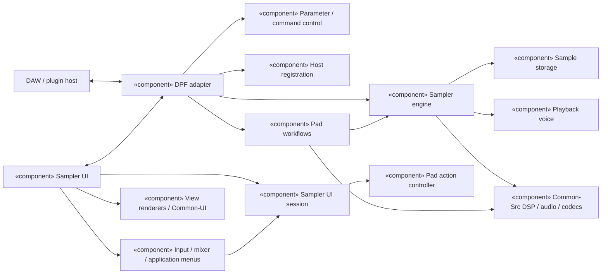
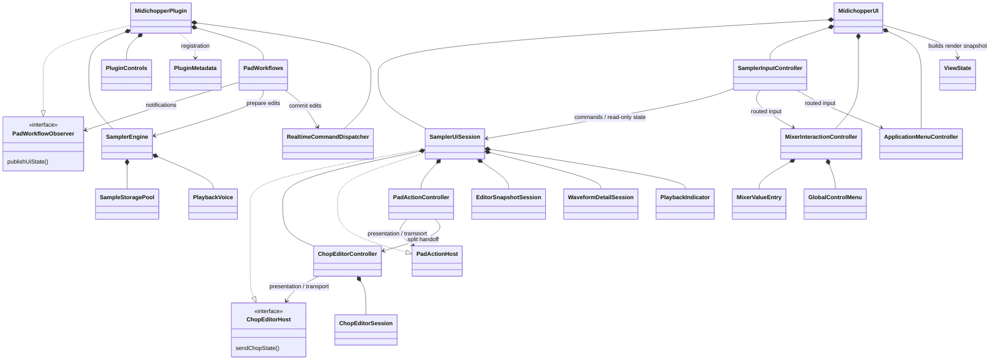

# Technical Architecture

SMS-Plugins builds native Linux audio plugins. Its current instrument,
SMS-Anville Sampler, separates audio processing, host integration, and the user
interface. VST3 is the preferred format; DPF supplies the format wrappers.

## Components

The adapter coordinates host lifecycle, state, MIDI, workers and output
publication. `PluginMetadata` registers parameters and state; `PluginControls`
owns atomic parameter values and translates queued commands into engine calls.
`PadWorkflows` prepares file import/export, clipboard and pad-edit transactions
on the control thread. The engine owns capture timing, voice selection, pad
publication and logical capacity. Each pad's `PlaybackVoice` owns its cursor,
envelope, interpolation and effects; `SampleStoragePool` owns PCM and blocks.

`MidichopperUI` adapts DPF callbacks, host effects and graphics resources.
`SamplerUiSession` owns sampler state, selection, audition and editor reply
synchronization. It exposes read-only state and typed edit commands.
`SamplerInputController` owns input precedence, key/pointer capture and waveform
gestures. `MixerInteractionController` owns mixer gestures, numeric entry and
global-control settings; `ApplicationMenuController` owns layout/skin menus and
CLEAR PADS confirmation. `PadActionController` owns pad menus and asynchronous
file/clipboard/structure requests within the session.

These controllers are independent of DPF and graphics resources. The
`anvillesampler_ui_controllers` library is shared by format UIs and tests that
check host effects, event ordering and stale replies without opening a window.
`MidichopperView.cpp` composes a frame from immutable `ViewState`.
Separate main, sample editor, cut editor and menu renderers own their drawing;
`ProductControlsRenderer` shares product controls between them. The render
context borrows only the canvas and state for that frame.

## Classes and responsibilities

`SampleStoragePool` owns capture reserve, immutable imports, block maps and
reclamation. `PadWorkflows` owns clipboard snapshots and split plans.
`ChopEditorController` owns cut/split opening, navigation, preview and Apply.
`EditorSnapshotSession` matches waveform/settings replies;
`WaveformDetailSession` owns zoom and detail requests. `PlaybackIndicator`
tracks displayed playback, and `MixerValueEntry` handles numeric editing.

## Thread boundaries

Audio uses preallocated storage. It does not allocate, free, lock, wait, perform
I/O or throw. Control work prepares immutable audio and asks the audio owner to
commit bounded changes at block boundaries. Generations reject stale edits.
Raw-preview requests use a three-slot latest-value mailbox: play/stop, pads and
frame bounds remain one coherent value even when a newer request supersedes it.

VST3 uses an instance-owned control worker and a bounded UI message bus. LV2 uses
its host worker and state callbacks. Waveform scans and file I/O stay outside
the audio callback. `Common-Src` remains independent of DPF and this instrument;
DPF-specific reusable drawing belongs to `Common-UI`.

## Reading the implementation

Start with the [engine](../SMS-AnvilleSampler/src/core/SamplerEngine.hpp),
[storage pool](../SMS-AnvilleSampler/src/core/SampleStoragePool.hpp),
[pad workflows](../SMS-AnvilleSampler/src/plugin/PadWorkflows.hpp), and
[cut editor](../SMS-AnvilleSampler/src/ui/ChopEditorController.hpp).
The [voice](../SMS-AnvilleSampler/src/core/PlaybackVoice.hpp),
[parameter controls](../SMS-AnvilleSampler/src/plugin/PluginControls.hpp),
[pad actions](../SMS-AnvilleSampler/src/ui/PadActionController.hpp) and
[renderer entry points](../SMS-AnvilleSampler/src/ui/ViewRenderers.hpp) define
the smaller component boundaries.
The UI [session](../SMS-AnvilleSampler/src/ui/SamplerUiSession.hpp),
[input router](../SMS-AnvilleSampler/src/ui/SamplerInputController.hpp),
[mixer](../SMS-AnvilleSampler/src/ui/MixerInteractionController.hpp) and
[application menus](../SMS-AnvilleSampler/src/ui/ApplicationMenuController.hpp)
define the host-independent interaction contracts.
The [engineering reference](../SMS-AnvilleSampler/Docs/ARCHITECTURE.md) describes
MIDI, capture and state contracts; the [storage contract](AI/PAD-STORAGE.md)
details ownership.
Public version compatibility is defined in the
[release procedure](RELEASING.md#public-version-compatibility).
