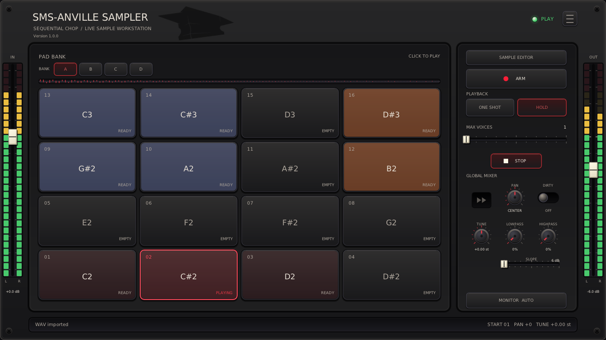
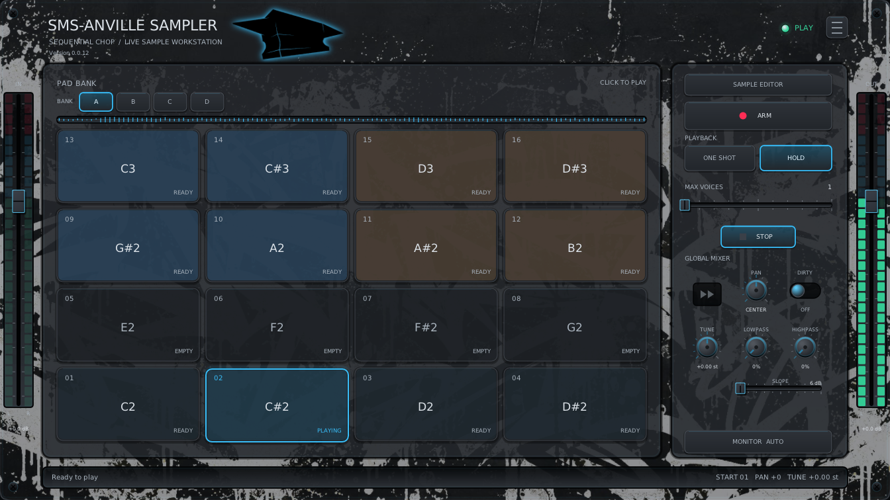
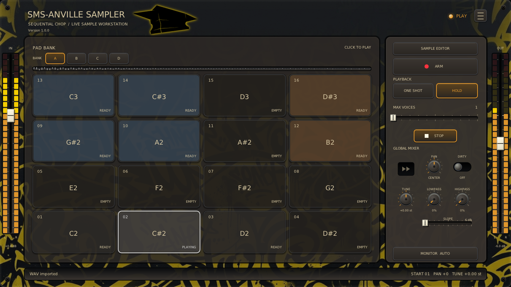
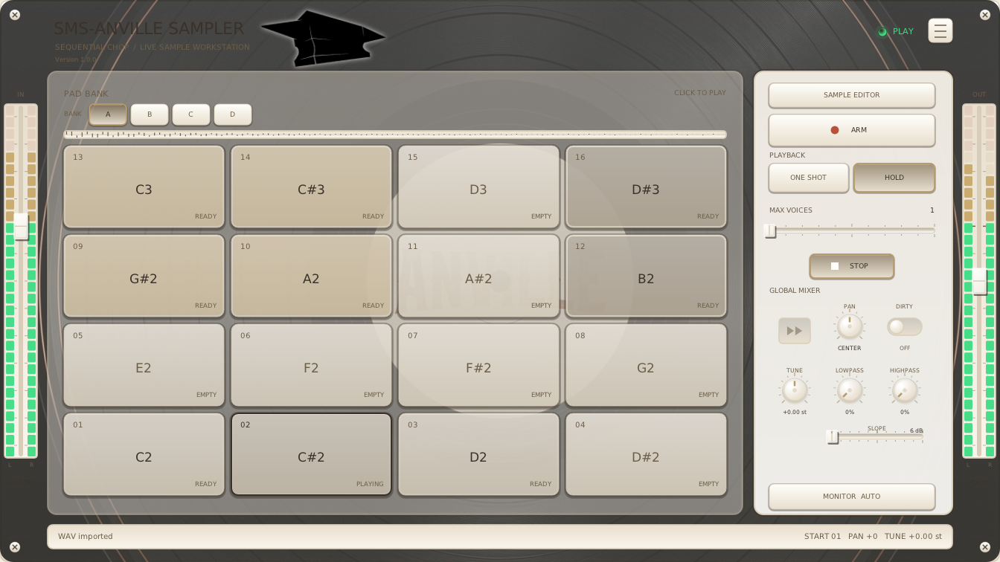

# SudoMetalStudio Plugins

_Professionally developed audio plugins for **Linux** (VST3/LV2) and **Windows** (VST3)._

## Plugins

### [SMS-Anville Sampler](SMS-AnvilleSampler/README.md) — live stereo chopping sampler

[Read More!](SMS-AnvilleSampler/README.md)

#### Alternative skins
| Finnish Dream | Looks like Wu | White Cadillac Vinyl |
| --- | --- | --- |
|  |  |  |

## About the developer & this project
> Hi,
>
> I'm Simo "Sipe" Erkinheimo, a professional software engineer with an M.Sc. in Information Technology
> and roughly two decades of experience in software development, architecture, and product engineering.
>
> ### 🤖🤮 Yet another f*cking AI-generated project?
>
> There's a strong anti-AI sentiment in parts of the creative and software development communities.
> I understand many of the concerns, and even share some of them. The barrier to creating software
> has never been lower, and many communities are now flooded with mediocre projects.
> People are understandably getting tired of it.
>
> I use AI-assisted development tools extensively. AI significantly speeds up implementation, but it
> doesn't replace engineering experience, architecture, testing, judgment, or responsibility for the end result.
>
> So, is this another slop project? **Absolutely not.**
>
> What matters isn't whether AI was used, but the quality of the result and the commitment to maintaining it.
>
> ### My commitment
>
> My name is real, and you can easily find my professional background and development history.
>
> All SMS-Plugins source code is publicly available, including its development history. You're welcome to inspect it, review it, and challenge my engineering decisions.
>
> **Whether a line of code was written by me or generated by AI, the responsibility for what I publish is entirely mine.**
>
> ### And how is this funded?
>
> It isn't. 😅💸
>
> At least for now, this is a 100% pro bono hobby project, driven by my passion for music, software engineering, and building tools I'd actually want to use myself.
>
> I choose **quality over quantity**. Slow and steady. I only build what I'm willing and able to maintain, with a focus on usability and simple, clear functionality.
>

## License

Copyright (c) 2026 SudoMetalStudio.

Repository content (excluding [third_party](third_party/) content): [AGPL-3.0-only](LICENSE).

> **NOTE:** This project was developed extensively with AI assistance, which introduces some legal uncertainty regarding copyright protection for AI-generated contributions.
>
> While I retain copyright over my original creative contributions, the extent to which individual AI-generated portions qualify for copyright protection remains legally unsettled.
>
> Since copyleft obligations rely on copyright, this uncertainty may also affect the enforceability of the AGPL license for certain portions of the code.
>
> My intention is simple: I built something useful for the community, and I want anyone building upon it to keep their improvements available to that community.
>
> If you discover a legal loophole and deliberately exploit it against that intention, you're a dick. 🫵

Additional permission: [DAW host-linking exception](HOST-LINKING-EXCEPTION.txt).
Third-party licenses remain unchanged, but listed for convenience.

Bundled dependencies:

| Component | License |
| --- | --- |
| DPF/DGL | [ISC](third_party/DPF/LICENSE) |
| travesty (VST3) | [ISC](third_party/DPF/distrho/src/travesty/base.h) |
| LV2 headers | [ISC](third_party/DPF/distrho/src/lv2/lv2.h) |
| CLAP headers | [MIT](licenses/CLAP-MIT.txt) |
| Pugl | [ISC](third_party/DPF/dgl/src/pugl-upstream/COPYING) |
| NanoVG / Fontstash | [zlib](third_party/DPF/dgl/src/nanovg/LICENSE.txt) / [zlib](third_party/DPF/dgl/src/nanovg/fontstash.h) |
| stb_image | [Public-domain; fallback permission](third_party/DPF/dgl/src/nanovg/stb_image.h) |
| stb_truetype | [MIT or public-domain dedication](third_party/DPF/dgl/src/nanovg/stb_truetype.h) |
| libSOFD (X11 file dialog) | [MIT](third_party/DPF/distrho/extra/sofd/libsofd.c) |
| DejaVu Sans font | [Bitstream Vera / Arev terms; DejaVu changes public domain](third_party/DPF/dgl/src/resources/LICENSE-DejaVuSans.ttf.txt) |
