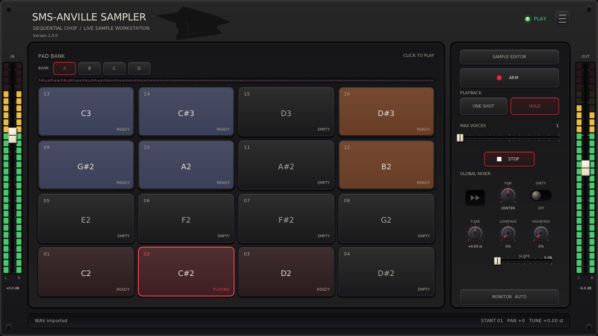
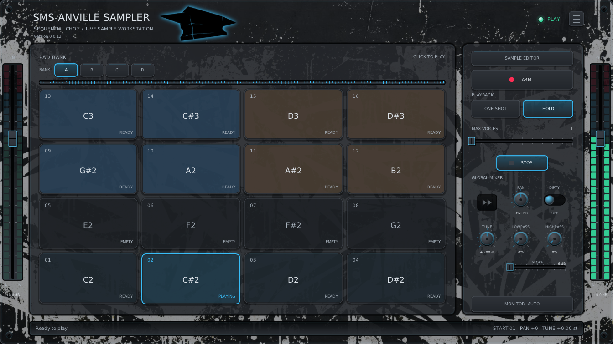
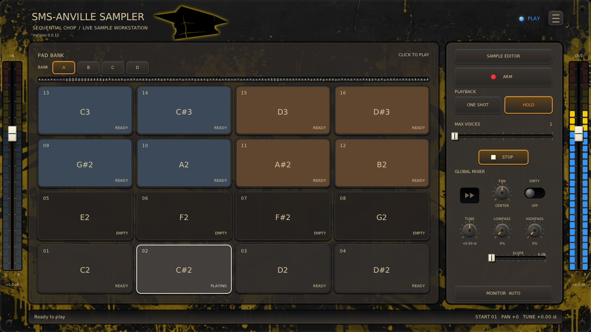

# SudoMetalStudio Plugins

> [!WARNING]
> 
> **STILL IN ALPHA - PLEASE WAIT FOR v1.0.0 BEFORE USING**

_Professionally developed, **Linux-native** audio plugins._
Windows and macOS versions may follow later.

## Plugins

### [SMS-Anville Sampler](SMS-AnvilleSampler/README.md) — live stereo chopping sampler
  for LV2 and VST3.

| Default Skin | Finnish Dream | Anville Graffiti |
| --- | --- | --- |
| [](SMS-AnvilleSampler/Docs/main-view.png) | [](SMS-AnvilleSampler/Docs/main-view-finnish-dream.png) | [](SMS-AnvilleSampler/Docs/main-view-anville-graffiti.png) |

## About the developer & this project
> Hi,
>
> I'm Simo "Sipe" Erkinheimo, a professional software engineer with an M.Sc. in Information Technology and roughly two decades of experience in software development, architecture, and product engineering.
>
> ### 🤖🤮 Yet another f*cking AI-generated project?
>
> There's a strong anti-AI sentiment in parts of the creative and software development communities. I understand some of the concerns, and even share a few of them. But I don't agree with the blanket rejection of AI-assisted development.
> 
> Like many professional developers today, I use AI-assisted development tools extensively, and I'm completely transparent about it.
>
> Today's AI tools make software development more accessible than ever, but they also give experienced developers extraordinarily powerful tools for turning ideas into real, maintainable products. AI doesn't replace engineering experience, architecture, testing, judgment, or responsibility for the end result.
>
> _For many of us, it's the extra pair of hands we always wished we had._
>
> And that's largely what makes this project possible. I can develop and maintain software that would otherwise require considerably more time and resources.
>
> Don't like it? Don't use it.
>
> ### ⚠️ But it also comes with a new troubling issue
> 
> When *anyone* can suddenly create and distribute software, how do **you**, the user, know it won't randomly crash your DAW? Or worse, how do you know the developer's intentions aren't **malicious**?
>
> 👉 A native audio plugin isn't just an audio processor. It's executable code running inside your DAW, potentially with access to everything your user account can access.
> 
> Unfortunately, there's no silver bullet for determining whether software or its developer can be trusted. However, I believe two things can make a meaningful difference:
> - **Accountability.** Know who's behind the software. Look for an established identity, a verifiable track record, and someone willing to take responsibility for what they publish.
> - **Transparency.** Open-source software allows others to inspect, review, and scrutinize the implementation. It doesn't guarantee safety, but it makes independent verification possible.
>
> ### My commitment
> 
> My name is real, and you can easily find my professional background and development history.
> 
> All SMS-Plugins source code is publicly available, including its development history. You're welcome to inspect it, review it, and challenge my engineering decisions.
>
> **Whether a line of code was written by me or generated by AI, the responsibility for what I publish is entirely mine.**
> 
> ### And how is this funded?
> 
> It isn't. 😅💸
> 
> At least for now, this is a 100% pro bono hobby project, driven by my passion for music, software engineering, and building tools I'd actually want to use myself.
>
> I choose **quality over quantity**. Slow and steady. I only build what I'm willing and able to maintain. The focus is on usability and simple, clear functionality.
>

## Quick Start: AI autopilot in an isolated container

> For those interested in learning containerized AI-driven development, here's a quick start for you. You are more than welcome to fork and learn, but please note:
>
> **I do NOT take pull requests**.
>

Requirements: Ubuntu Linux and a ChatGPT plan with Codex access, such as Plus.

1. Install [Visual Studio Code](https://code.visualstudio.com/) and its
   [Dev Containers extension](https://marketplace.visualstudio.com/items?itemName=ms-vscode-remote.remote-containers).

2. Install Docker and add your user to its group:

   ⚠️ Security note: Adding your user to the docker group grants root-equivalent privileges through the Docker daemon. This is a common development setup, but you should understand its security implications. Docker's rootless mode is an alternative, although compatibility with this development environment has not been verified.

   ```bash
   sudo apt update
   sudo apt install docker.io
   sudo systemctl enable --now docker
   sudo usermod -aG docker "$USER"
   sudo reboot
   ```

   **Reboot before opening VS Code.** Logging out may leave VS Code background processes without Docker permission.

3. Clone and open the repository:

   ```bash
   git clone --recurse-submodules https://github.com/sirsipe/SMS-Plugins.git
   code SMS-Plugins
   ```

4. In VS Code, run **Dev Containers: Reopen in Container**. The first image
   build downloads the complete audio, GUI, and AI toolchain and can take
   several minutes. Later starts are much faster.

5. Open the Codex panel on the right and sign in. Select **Full access** for the
   isolated container and choose a model available to your account. Start with
   the default reasoning effort; increase it when a task needs deeper analysis.

6. Try this prompt:

   > Hello! Make the ARM button of SMS-Anville Sampler red, test it, and show me a
   > picture of how it looks.

7. (*Optional*) - To satisfy your curiosity, follow the agent's virtual screen at
   [http://localhost:6080/vnc.html](http://localhost:6080/vnc.html).

Inside the container, an AI agent can build and install the plugin, run its tests, launch Carla, operate the real plugin UI, and capture window-only screenshots.
The development container provides an additional layer of isolation for Full access. The agent can modify the project checkout and access the network, but the container is configured without access to the host's home directory, graphical session, audio devices, Docker socket, private keys, or unrelated repositories.
**Container isolation reduces risks but doesn't eliminate them.**

See [Contributing](CONTRIBUTING.md) for manual development and validation.
