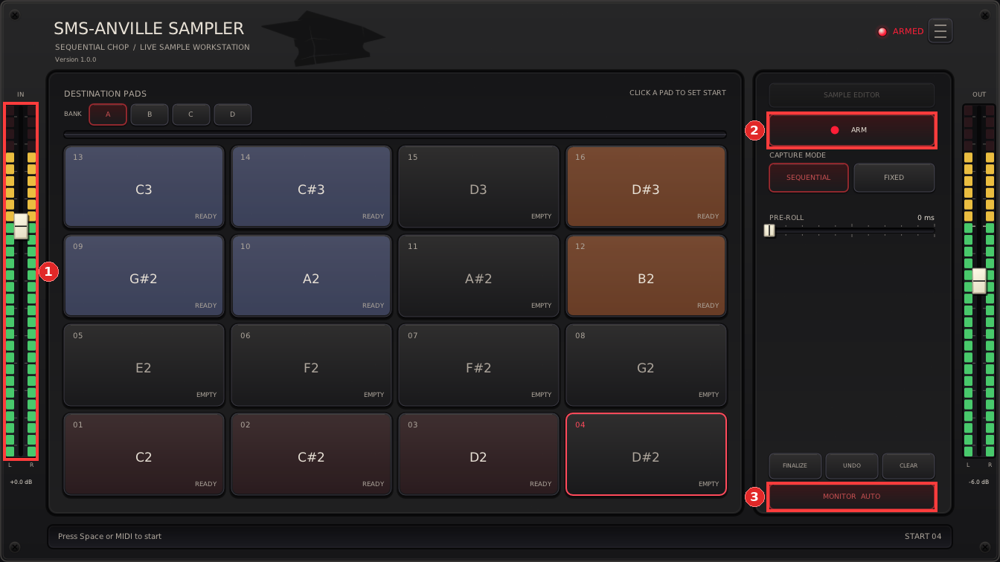
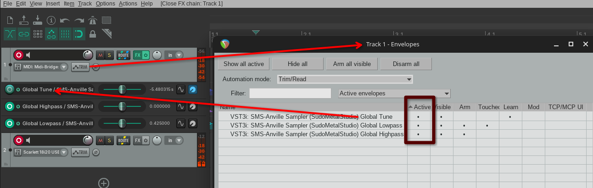

# REAPER guide

Set up SMS-Anville Sampler in REAPER, load or capture samples, and control it
from MIDI. For the plugin's controls, see the [general walkthrough](../README.md#general-walkthrough).

## Track and controller setup

1. Insert a new track, arm the track, select your MIDI controller as its input,
   and enable input monitoring.
2. Open the track's **FX** window and load **SMS-Anville Sampler**.
3. If the default 4×4 layout doesn't match your controller, choose an alternative
   under **☰ → Pad Layout**. **Bank Mode → SELECTED · SHARED** uses the same
   notes for all four banks; select the bank you want to play in the plugin.
   **ALL BANKS · UNIQUE** gives each bank its own note range.

You can also choose a skin under **☰ → Skin**. 😉

## Load samples

Right-click a pad and choose **Import WAV...** to load a
[compatible WAV file](WAV-FILES.md). Repeat for other pads, then trigger them
from MIDI or click them in PLAY mode.

## Record and chop

1. Add a second track for the audio source. 
2. Drag **ROUTE** from the new audio track to the MIDI track's **ROUTE**. 
3. Right click the **ROUTE** from the new audio track and disable **Master Send**
4. Play an audio item on the new track, or select your audio input, arm that track, and enable monitoring for live input.

The sampler's input meter (1) should respond. **Monitor Auto** (3) passes the
input to the output while **ARM** (2) is enabled; choose **Monitor On** to hear
it in PLAY mode too.

5. Switch the plugin to **ARM** mode. It selects the first empty pad; click a
   different pad if you want to change the starting destination.
6. Focus the plugin and press **Space**, or send any MIDI note-on, to start
   recording. Each later press/note closes the current slice and records into
   the next pad. Choose **Finalize** or leave ARM mode to keep the last slice.
7. Right-click pads for **Split Sample...** or **Adjust cut points** to refine
   your slices. See the [cut-point guide](CHOP-EDITOR.md).

## MIDI Learn

In **Options → Preferences → MIDI Inputs**, enable your controller for control
messages as well as track input.

1. Move a global knob/slider or click the plugin button you want to control.
2. Immediately choose **Param → Learn** in REAPER's FX window.
3. Move the hardware control, then accept with **OK**. For a momentary button
   controlling a toggle, choose **CC mode → Toggle**.

Per-pad mixer/FX controls are not exposed for host MIDI Learn or automation.
Right-click supported global knobs to set their value mode or restrict their
[range](../README.md#knob-settings) for finer controller adjustments.

## Record automation

1. Open **Track Envelopes/Automation** on the sampler track. Find the plugin
   parameters you want to record and enable **Active**, **Visible**, and **Arm**
   for those envelopes.
2. Change the track's automation mode from **Trim/Read** to **Touch** or **Latch**.
   Active/Visible alone does not record movements; the screenshot below shows
   envelope selection before this mode change.
3. Start REAPER playback and move the plugin controls or their learned hardware
   controls. Stop when finished, switch to **Read**, and play back to check the
   recorded movements. Leave write modes before listening to avoid overwriting
   the envelopes.

See the [REAPER User Guide](https://www.reaper.fm/userguide.php) for automation
mode details and host preferences.
