# SMS-Anville Sampler

> [!WARNING]
> 
> **STILL IN ALPHA - PLEASE WAIT FOR v1.0.0 BEFORE USING**

_Stereo chopping sampler._ [Downloads](https://github.com/sirsipe/SMS-Plugins/releases).
 - Linux VST3 (preferred)
 - Linux LV2
 - Windows VST3 (experimental)


> Thanks to **Manolo Anville** ([@ManoloAnville](https://github.com/ManoloAnville)).

[](Docs/main-view.png)

#### Bundled Skins
**Hamburger → Skin** offers **Finnish Dream**, **Looks like Wu**, and
**White Cadillac Vinyl** and remembers your choice. **Default** uses the built-in appearance. [Customization](Docs/SKINS.md).

| Finnish Dream | Looks like Wu | White Cadillac Vinyl |
| --- | --- | --- |
| [](Docs/main-view-finnish-dream.png) | [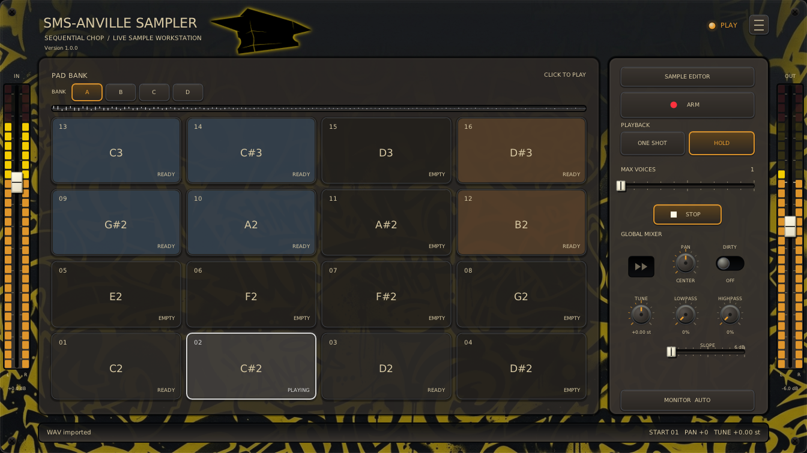](Docs/main-view-looks-like-wu.png) | [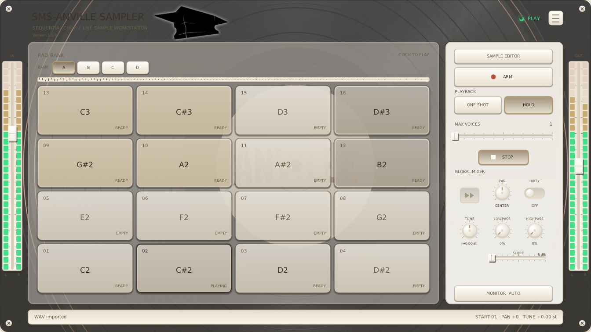](Docs/main-view-white-cadillac-vinyl.png) |

Captures: v0.0.13.

**VST3 preferred** for GUI/testing. LV2 is mostly AI-tested; Windows VST3 has minimal testing.

Tested in **REAPER**, **Ardour**, **Carla**.

- MIDI capture/chop or sample loading; waveform editing and splitting.
- Pad/global FX: per-pad Forward/Reverse, Gain, Pan, Dirty, Tune and filters; per-sample ADSR.
- 2x4/3x4/4x4 pads; four MIDI banks; pad colors.
- VST3 presets transfer samples/settings between Ardour and REAPER; Carla lacks support.

> v1.0.0+ is incompatible with alpha sessions (v0.0.1–v0.9.9). Alpha releases were removed from GitHub to avoid confusion.

## Basic Usage

1. Insert on a REAPER instrument track with stereo audio/MIDI, or an Ardour
   MIDI track with stereo sidechain. Rescan if listed as FX.

2. Press **ARM** (red circle) to arm; release for PLAY. Indicators are red
   ARMED and green PLAY by default; skins can recolor them. The first empty pad is selected; click another while idle.

3. **Any MIDI note-on or Space press starts the first slice.** Later taps close
   the current slice and continue at the next pad.

4. **FINALIZE** or releasing **ARM** keeps the open slice. **UNDO** discards the
   open/last slice; **CLEAR** clears banks after confirmation.

5. Right-click a pad to edit, split, or adjust neighbouring cuts.

### ARM view


### Menus


Hamburger: **PAD LAYOUT**, **BANK MODE**, **SKIN**, **RESET**, **LINKS**. Online Help opens this guide; Report Issue opens issues.

Click **RESET**, then **CONFIRM: RESET** within two seconds to clear pads/settings/colors/clipboard
and restore defaults. Layout, bank mode and skin remain. Dismissing the menu or
choosing another item cancels confirmation. Reset is unavailable during pad operations.

**All Banks** (default) uses unique notes for gapless play; **Selected Bank** shares
notes within the active bank. All Banks base note is limited to 64.

Layouts preserve samples. Menu selections remember defaults in
`SMS-AnvilleSampler/selected-layout` and `selected-bank-mode`, beside the
[skin preference](Docs/SKINS.md#remembering-a-choice). Host values always win;
LV2 normally initializes to 16 pads/All Banks. Invalid preferences use
those defaults. Host changes do not update preferences.


### Sample Editor view

**SAMPLE EDITOR** opens waveform, ADSR, and pad mixing; **MAIN VIEW** returns.
Selection cycles Play on Select (once), Loop on Select, Off. Loop repeats
Start/End after release, restarting ADSR. Audition is independent of main playback. See the [mixing guide](Docs/MIXING.md) for controls.

**Ctrl + wheel** zooms; **Shift + wheel** scrolls. Changing pads resets the view.

[](Docs/sample-editor.png)

#### Alternative skins
| Finnish Dream | Looks like Wu | White Cadillac Vinyl |
| --- | --- | --- |
| [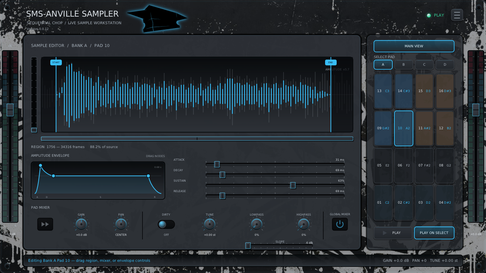](Docs/sample-editor-finnish-dream.png) | [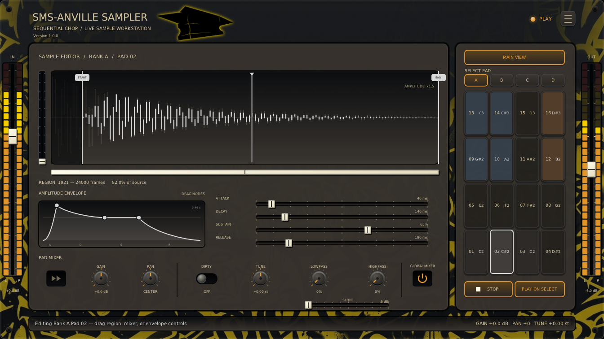](Docs/sample-editor-looks-like-wu.png) | [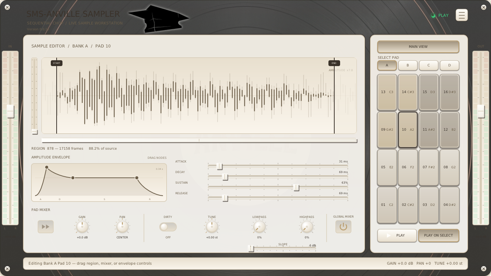](Docs/sample-editor-white-cadillac-vinyl.png) |


### Adjust Cut Points view

Right-click a middle pad for **Adjust cut points**. See the
[cut-point guide](Docs/CHOP-EDITOR.md).

[](Docs/adjust-cut-points.png)

#### Alternative skins
| Finnish Dream | Looks like Wu | White Cadillac Vinyl |
| --- | --- | --- |
| [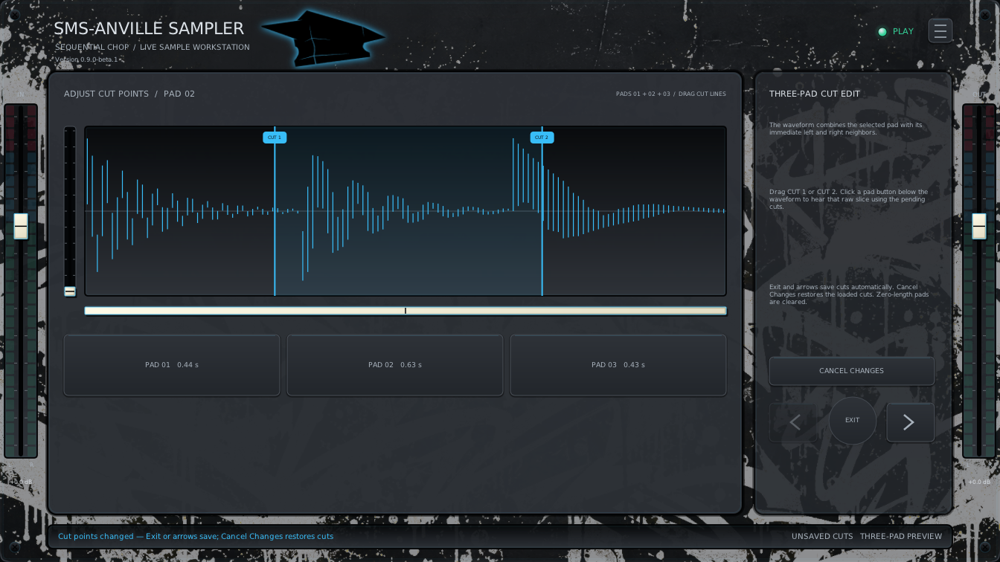](Docs/adjust-cut-points-finnish-dream.png) | [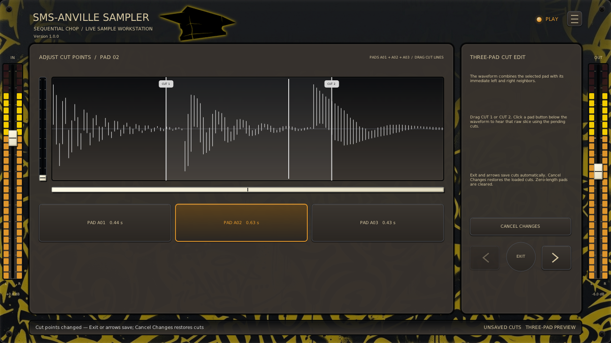](Docs/adjust-cut-points-looks-like-wu.png) | [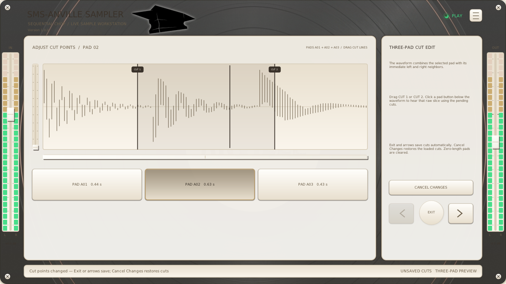](Docs/adjust-cut-points-white-cadillac-vinyl.png) |


### Split sample view

Right-click for **Split Sample**; following samples shift right without being overwritten.

[](Docs/split-sample.png)

#### Alternative skins
| Finnish Dream | Looks like Wu | White Cadillac Vinyl |
| --- | --- | --- |
| [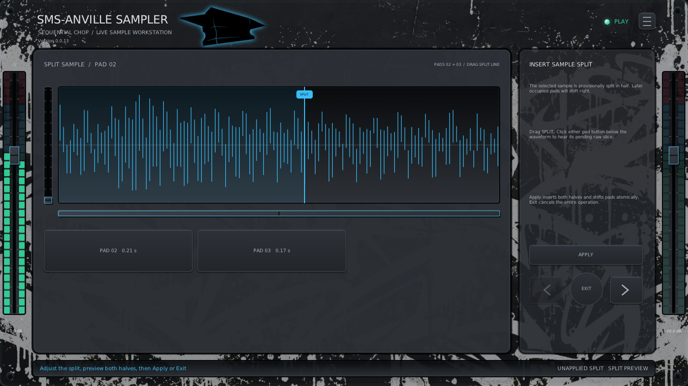](Docs/split-sample-finnish-dream.png) | [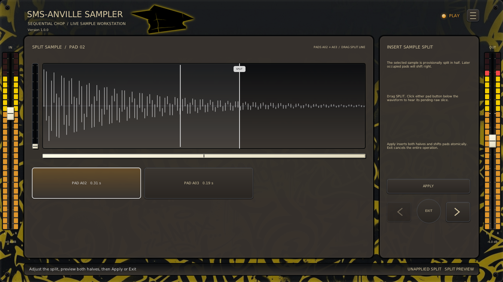](Docs/split-sample-looks-like-wu.png) | [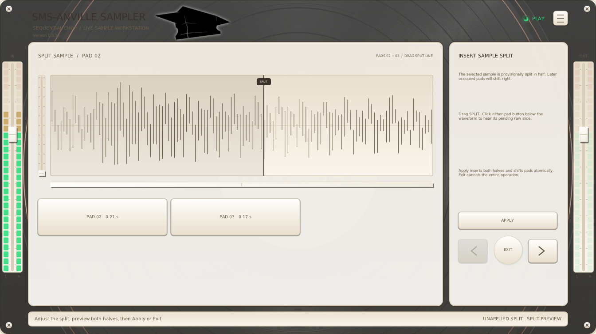](Docs/split-sample-white-cadillac-vinyl.png) |


## General Controls

- Drag/wheel knobs and sliders.
- **Shift** gives 10× knob precision; **Ctrl** steps Gain/Volume 1 dB, Pan 10%, and Tune one semitone.
- Double-click values to enter exact values; double/middle-click knobs, ADSR, or
  edge faders to reset.
- Wheel adjusts ADSR, Start/End, cuts.
- Click for focus. **Space** plays/stops in PLAY/editor or
  starts/chops ARM capture; holding does not repeat. Menus, dialogs, numeric
  entry, and cut-point views suppress Space. Enable key sending if the DAW intercepts it.

## Other controls

- Memory: ~8 minutes.

- Monitor cycles Off, On, and Auto (on when ARMed).

- Max Voices limits simultaneous pads, stealing the oldest at capacity;
one gives monophonic playback.

- **Hold** loops Start/End while its MIDI note or mouse press is held. Release
starts the ADSR fade; looping continues until it ends. ARM stops Hold; **One Shot**
ignores note-off. Switching banks while holding keeps playback running; releasing
the note still releases its original pad, including in shared MIDI bank mode.

- Pre-roll moves boundaries earlier for late taps; Fixed mode records one fixed
length slice per note-on.

- Defaults: Auto monitoring, one voice, Play on Select, and
6 dB/octave filter slopes.

- Pad actions: copy/paste/import/export/clear/split/collapse gaps.
  Split/Collapse Gap stay within the active bank; copies can cross banks.

- Right-click a pad for **Color**; tint persists when empty.

- See [WAV files](Docs/WAV-FILES.md) for import formats and requirements.

- DAW projects store all banks as 16-bit stereo.

- Stereo LEDs show raw input/final output.

## Vision, Contributions, License

[Contributing](../CONTRIBUTING.md).

License: [MIT](LICENSE).

Product direction: [Vision](Docs/VISION.md).

## Build

Ubuntu/Debian:

```bash
sudo apt install build-essential cmake ninja-build pkg-config git python3 \
  lv2-dev libgl1-mesa-dev libx11-dev libxext-dev \
  libxrandr-dev libxcursor-dev libxinerama-dev libdbus-1-dev xdg-utils
```

Build:

```bash
git submodule update --init --recursive
cmake -S SMS-AnvilleSampler -B build -G Ninja \
  -DCMAKE_BUILD_TYPE=Release -DBUILD_TESTING=ON \
  -DANVILLESAMPLER_BUILD_VST3=ON
cmake --build build
ctest --test-dir build --output-on-failure
```

VST3/LV2 bundles appear under `build/bin`. Install per user:

```bash
mkdir -p ~/.lv2
cp -a build/bin/SMS-AnvilleSampler.lv2 ~/.lv2/
mkdir -p ~/.vst3
cp -a build/bin/SMS-AnvilleSampler.vst3 ~/.vst3/
```

## Technical Architecture

See [Technical Architecture](../Docs/ARCHITECTURE.md).
