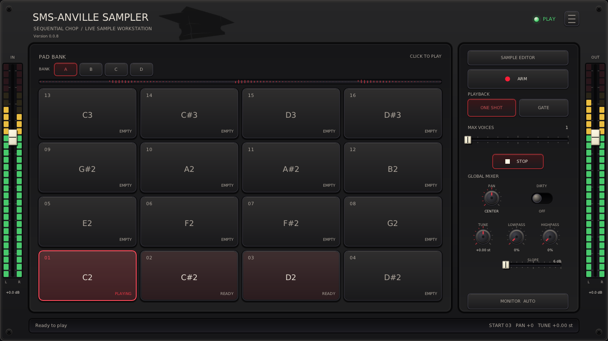
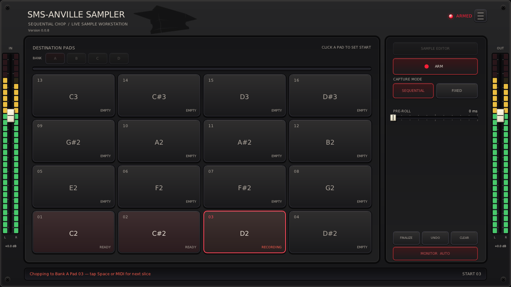
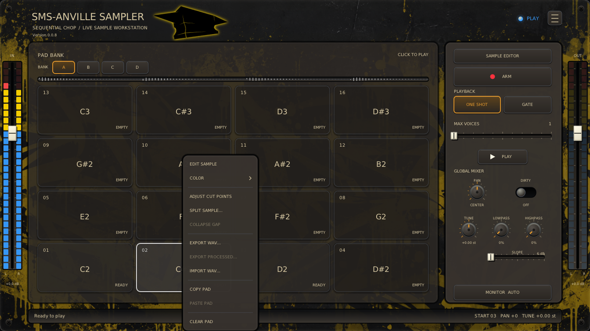
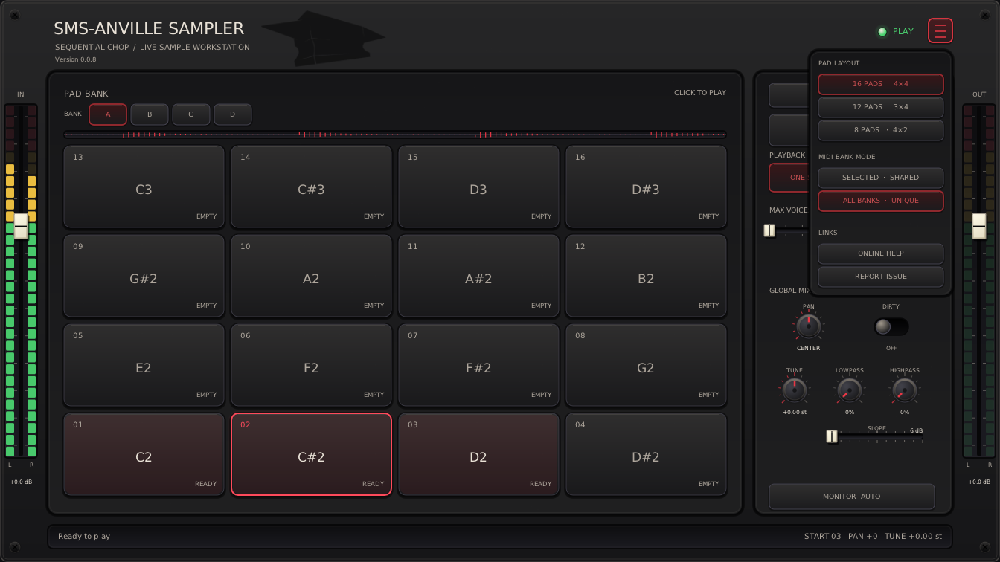
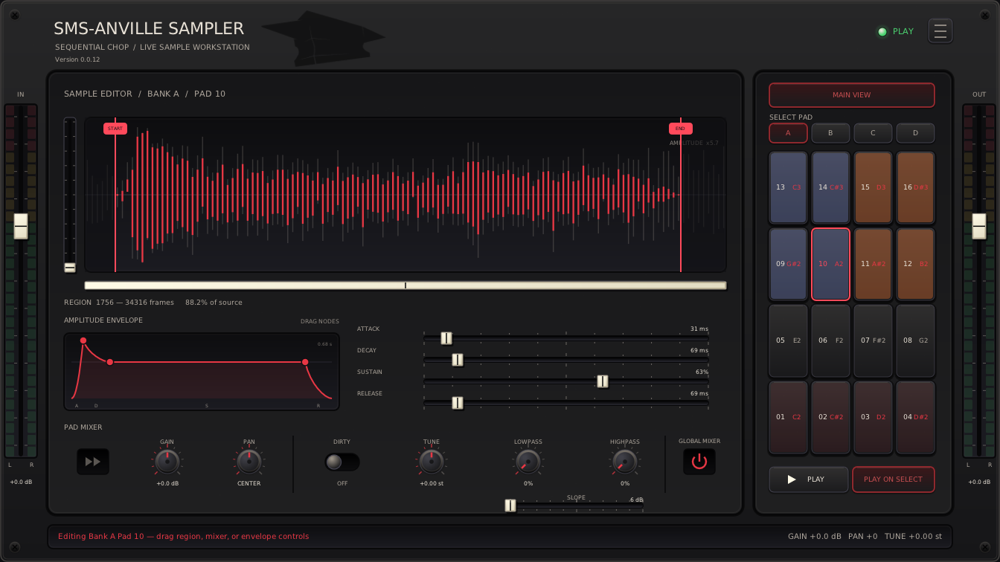
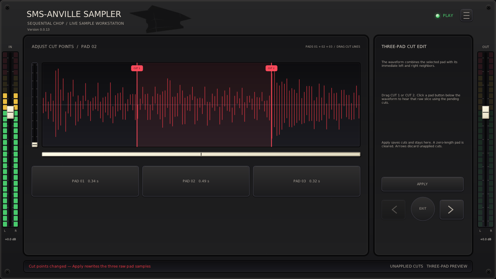
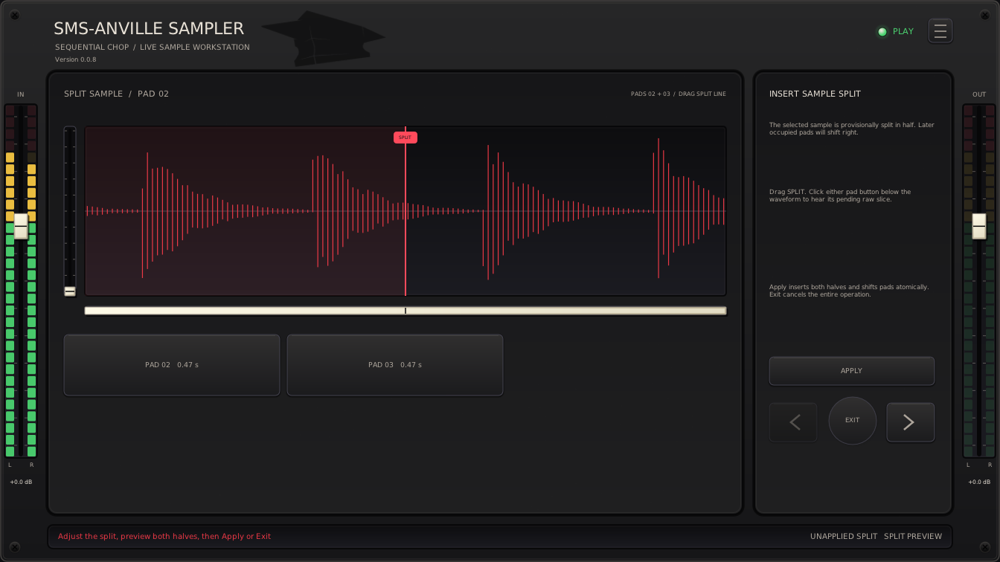

# SMS-Anville Sampler

_A live stereo chopping sampler for Linux._

> Special thanks to **Manolo Anville** ([@ManoloAnville](https://github.com/ManoloAnville)) for collaboration.




**VST3 is preferred:** faster GUI loading and more human testing. LV2 is mostly
AI-tested; CLAP is untested.

Tested: **REAPER**, **Ardour**, **Carla**.

- Control with any MIDI controller.
- Capture/chop input or load samples into pads.
- Waveform editing and splitting.
- Pad/global mixer/FX: per-pad Forward/Reverse, Gain, Pan, Dirty, Tune (Varispeed), and Lowpass/Highpass with 6/12/24 dB slopes; independent monitor/playback levels.
- Sample specific amplitude envelope; Attack, Decay, Sustain, Release.
- Layouts: 2x4, 3x4, or 4x4 pads; four shared/unique MIDI banks; pad colors.
- VST3 presets store samples/settings across supported DAWs: Ardour presets also
  load in REAPER and vice versa. Carla does not support them.
- Skins? **Yes!** - Create your own!

> Versions 1.0.0+ are not backwards compatible with alpha releases (v0.0.1-v0.9.9). Alpha releases have been removed from GitHub releases to avoid confusion.

## Basic Usage

1. Insert **SMS-Anville Sampler** as an instrument on a REAPER track receiving stereo audio/MIDI, or an Ardour MIDI track with stereo input sidechain for capture. Rescan after upgrading if listed as FX.

2. Press **ARM** (red record circle) to arm; release it for PLAY.
   Bundled header indicators: red ARMED, blue PLAY.
   The first empty visible pad is selected; click another while idle.

3. **The first MIDI note-on or Space press starts the slice.** Later taps close
   the current slice and continue at the next pad.
    > NOTE: **ANY** MIDI note-on (i.e. any pad of your controller) starts and chops.

4. **FINALIZE** or releasing **ARM** keeps the open slice. **UNDO** discards the
   open/last slice; **CLEAR** clears all banks after a confirmation click.

5. Right-click a pad to edit, split, or adjust cuts with neighbours.






The hamburger menu has layout and bank mode selection. **Online Help** opens this
guide from the matching tag in official releases, or from `main` in development
builds. **Report Issue** opens the project's issues page.

Select **All Banks** (unique notes, default) for gapless notes or **Selected Bank**
(shared notes) to reuse controller notes in the active bank. All Banks limits
the base note to 64.

Layouts match your controller and preserve samples.



**SAMPLE EDITOR** opens waveform, ADSR, and pad mixing; **MAIN VIEW** returns. See the
[mixing guide](Docs/MIXING.md). The selection button cycles through **Play on
Select**, **Loop on Select**, and Off (unpressed **Play on Select**). Play auditions
the selected sample once; Loop repeats its Start/End region after the mouse is
released, repeating ADSR each pass with live edits. Editor modes are independent
of the main playback mode.
Changing selection replaces the audition; turning it off or leaving the editor
stops it. **Play/Stop** plays the selected occupied pad when idle or immediately cuts all
playing samples. With Loop on Select enabled, editor Play/Stop and Space also start a loop.
Play/Stop shows triangle/square icons. ARM hides the global mixer.
The edge faders remain visible: **IN** controls monitoring, **OUT** controls
samples/previews.

**Ctrl + wheel** zooms the waveform; **Shift + wheel** scrolls. The left zoom
control and window box below provide drag alternatives. Changing pads resets
the view.



Right-click a middle pad for **Adjust cut points**. See the
[cut-point guide](Docs/CHOP-EDITOR.md).



Right-click for **Split Sample**; following samples shift right without being overwritten.



### General Controls

- Drag/wheel knobs and sliders.
- **Shift** gives 10× knob precision; **Ctrl** steps e.g. Gain/Volume 1 dB, Pan 10%, and Tune one semitone.
- Double-click values for exact entry.
- Double/middle-click knobs, ADSR sliders, or edge faders to reset.
- The wheel also adjusts ADSR, Start/End, and cut points.
- Click the plug-in for keyboard focus. **Space** plays/stops in
  PLAY and Sample Editor, or starts/chops capture in ARM. Holding Space does not
  repeat. Menus, file dialogs, numeric entry, and cut-point views suppress it.
  The plug-in consumes Space when delivered; a DAW that intercepts keyboard
  shortcuts first may require its option to send keys to the plug-in.

The bundled [graffiti skin](Docs/SKINS.md) loads automatically; customize its
images, colors, labels and pulsing logo halo.

## Other controls

- Sample memory: about eight minutes.

- Monitor cycles through Off, On, and Auto; Auto is On when ARMed and Off otherwise.

- Max Voices limits simultaneous pads. At capacity, a new trigger stops the
oldest voice; set it to one for monophonic playback.

- **Hold** loops a pad's Start/End region while its MIDI note or mouse press is
held. Release starts the pad's ADSR release; the region continues looping until
the fade ends. ARM stops Hold loops. **One Shot** ignores note-off.

- Pre-roll moves boundaries slightly earlier to compensate for late taps. Fixed
mode records one fixed-length slice per note-on.

- New sessions start with Auto monitoring, one voice, Play on Select enabled,
and 6 dB/octave filter slopes.

- Right-click pads to copy, paste, import, export, clear, split, or collapse a gap.
  Split Sample and Collapse Gap stay within the active bank. A copied pad can be
  pasted into another bank.

- Right-click a pad for **Color**; its tint is saved, even when empty.

- See [WAV files](Docs/WAV-FILES.md) for supported import formats and Linux requirements.

- DAW projects store all banks as 16-bit stereo state.

- Stereo LED rails around the faders show raw input and final output.


## Vision, Contributions, License

Development/testing: [Contributing](../CONTRIBUTING.md).

Licensed under [MIT](LICENSE).

See [Docs/VISION.md](Docs/VISION.md) for product direction and feature scope.

## Build

Ubuntu/Debian prerequisites:

```bash
sudo apt install build-essential cmake ninja-build pkg-config git python3 \
  lv2-dev libgl1-mesa-dev libx11-dev libxext-dev \
  libxrandr-dev libxcursor-dev libxinerama-dev libdbus-1-dev xdg-utils
```

From the repository root:

```bash
git submodule update --init --recursive
cmake -S SMS-AnvilleSampler -B build -G Ninja \
  -DCMAKE_BUILD_TYPE=Release -DBUILD_TESTING=ON \
  -DANVILLESAMPLER_BUILD_VST3=ON
cmake --build build
ctest --test-dir build --output-on-failure
```

The VST3 and LV2 bundles are produced under `build/bin`. Install them for the
current user with:

```bash
mkdir -p ~/.lv2
cp -a build/bin/SMS-AnvilleSampler.lv2 ~/.lv2/
mkdir -p ~/.vst3
cp -a build/bin/SMS-AnvilleSampler.vst3 ~/.vst3/
```

## Technical Architecture

See [Technical Architecture](../Docs/ARCHITECTURE.md).
