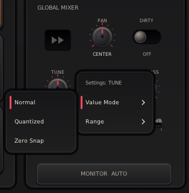

# SMS-Anville Sampler

> [!WARNING]
>
> **BETA - PLEASE WAIT FOR v1.0.0 BEFORE USING**

_Stereo chopping sampler that focuses on simplicity, usability, and professional-grade realtime engine._

Available in [Releases](https://github.com/sirsipe/SMS-Plugins/releases):

- Linux 64bit VST3
- Linux 64bit LV2[^lv2]
- Windows 64bit VST3

[^lv2]: VST3 is recommended: it has gone through more testing and seems to have better performance in some hosts.

Should work in any VST3 supporting DAW, but especially tested in:

* Linux: **REAPER**, **Ardour**, **Carla**.
* Windows: **Cubase**.


> Thanks to **Manolo Anville** ([@ManoloAnville](https://github.com/ManoloAnville)) for extensive collaboration!

[](Docs/main-view.png)

#### Bundled Skins
**Hamburger → Skin** offers **Finnish Dream**, **Looks like Wu**, and
**White Cadillac Vinyl** and remembers your choice. **Default** uses the built-in appearance. [Customization](Docs/SKINS.md).

| Finnish Dream | Looks like Wu | White Cadillac Vinyl |
| --- | --- | --- |
| [](Docs/main-view-finnish-dream.png) | [](Docs/main-view-looks-like-wu.png) | [](Docs/main-view-white-cadillac-vinyl.png) |

Captures: v0.0.13, except where noted.


## How to Install

Download your format's ZIP from [Releases](https://github.com/sirsipe/SMS-Plugins/releases).
Extract it and copy the **whole folder**, including skins and licenses:

| Format | Folder to copy | Destination |
| --- | --- | --- |
| Linux VST3 | `SMS-AnvilleSampler.vst3` | `~/.vst3/` |
| Linux LV2 | `SMS-AnvilleSampler.lv2` | `~/.lv2/` |
| Windows VST3 | `SMS-AnvilleSampler.vst3` | `C:\Program Files\Common Files\VST3\` |

Create missing destination folders. Restart your DAW or rescan plugins.
Linux x64 builds use Ubuntu 24.04; other distributions remain unverified.
Windows builds are unsigned. See [Windows runtime requirements](../Docs/AI/PLATFORM-BUILDS.md#windows-runtime-requirements).

## General Walkthrough

Host-specific setup: [REAPER guide](Docs/REAPER.md).

1. **Connect MIDI and audio.** Load the sampler on an instrument/MIDI track,
   route your controller to it, and enable track arming/monitoring as needed.
   For capture, also route stereo audio to its input/sidechain.

2. **Match your controller.** Choose **☰ → Pad Layout**. **Bank Mode → SELECTED ·
   SHARED** reuses the same notes for whichever bank you select; **ALL BANKS ·
   UNIQUE** gives each bank its own range.

3. **Load or capture samples.** Right-click a pad for **Import WAV...** to load a
   [compatible file](Docs/WAV-FILES.md). For live chopping, check the input meter,
   enable **ARM**, and use Sequential capture. Click a pad to choose the starting
   destination. Focus the plugin and press
   **Space**, or send any MIDI note-on, to start recording. Each later press/note
   closes a slice and starts the next. Choose **Finalize** or leave ARM to keep
   the last slice. **Monitor Auto** lets you hear the input while armed.

4. **Shape the pads.** Open **Sample Editor** for Start/End, ADSR and pad mixing.
   Right-click for **Split Sample...** or **Adjust cut points**. See the
   [cut-point guide](Docs/CHOP-EDITOR.md) and
   [mixing guide](Docs/MIXING.md).

5. **Perform and save.** Leave ARM to play pads with MIDI or clicks. Choose
   **One Shot** or **Hold**, select banks, and adjust global effects.
   Save your DAW project to retain samples and settings; host presets can also
   store arrangements where supported.

## MIDI control and automation

Use your DAW's MIDI Learn to bind hardware controls to global parameters. To
record movements, arm the parameter envelopes and select the host's automation
writing mode; return to playback mode afterward. Per-pad mixer/FX controls are
not exposed for host MIDI Learn or automation. Follow the
[REAPER MIDI Learn and automation steps](Docs/REAPER.md#midi-learn) for an example.

## Views and Menus

### ARM view


### Menus

#### Hamburger [☰]

**PAD LAYOUT**, **BANK MODE**, **SKIN**, **CLEAR PADS**, **LINKS**. Online Help opens this guide; Report Issue opens issues.


Layouts preserve samples. Explicit menu choices remember startup defaults in
`SMS-AnvilleSampler/defaults.ini`, beside the
[skin preference](Docs/SKINS.md#remembering-a-choice). The same file stores knob
settings. Existing instances retain their choices; new instances use the last
saved defaults. Host-restored settings always win and do not overwrite this
file. LV2 normally initializes layout/bank mode to 16 pads/All Banks. Missing
or invalid choices use factory defaults. Old separate preference files are
ignored; previous startup selections must be chosen again.

BANK MODE → **All Banks** (default) uses unique notes for gapless play; **Selected Bank** shares notes within the active bank. All Banks base note is limited to 64.


Click **CLEAR PADS**, then **Confirm: CLEAR PADS** within two seconds to clear
all banks' audio, pad edits, colors, and clipboard. Global control values,
knob settings, layout, bank mode, skin, and editor audition mode remain.
Dismissing the menu or choosing another item cancels confirmation. CLEAR PADS
is unavailable during pad operations.


#### Pad Context menu


#### Knob settings

Right-click global **PAN**, **TUNE**, **LOWPASS**, **HIGHPASS**, or the **OUT**
fader to open **Settings: <control>**. These settings belong to that control;
IN and pad controls retain their usual behavior.

[](Docs/knob-context-menu.png)

**Value Mode** chooses how incoming positions are interpreted:

- **Normal** (default) gives continuous values across the selected range.
- **Quantized** rounds to the same steps as Ctrl+wheel: 1 semitone for Tune,
  1 dB for OUT, and 10 percentage points for Pan and filters. All adjustments
  use these steps, including fine adjustment and typed values.
- **Zero Snap** holds exactly zero within ±5% of full control travel around
  its zero position, then smoothly sweeps to each endpoint. On strongly
  asymmetric ranges, the snap region narrows on the shorter side so that side
  remains adjustable. Other values stay continuous.

Selecting a different mode keeps the menu open; selecting the current mode
closes it. Escape or clicking outside also closes the menu.

**Range** maps the entire incoming host/controller range to your chosen audible
limits. For example, setting Tune to −6…+6 st spreads those 12 semitones across
the controller's full 0–127 travel, giving finer control. Click **Min** or
**Max**, type a value, and press Enter or numpad Enter. Tab accepts a valid
limit and edits the other one; Escape cancels. Invalid entries remain open.
Limits must stay inside the original range, with Min below Max. Quantized
requires at least one available step. A range excluding zero is accepted and
switches Zero Snap to Normal.

Original limits appear right-aligned in parentheses. Middle-click either row
to restore that limit alone. **RESET → Confirm: RESET** restores both limits
while preserving Value Mode; confirm within two seconds. RESET is disabled
when both limits already match the originals.

Mode and range changes immediately reinterpret current positions in both the
UI and audio, including existing automation. The full raw values remain
stored, so switching settings does not discard their precision. Knob settings
save with the DAW session as private plugin state without extra automation
parameters. Explicit choices also become startup defaults for new instances;
CLEAR PADS preserves them. Host controls still expose their original ranges,
while the plugin shows the interpreted values.

### Sample Editor view

**SAMPLE EDITOR** opens waveform, ADSR, and pad mixing; **MAIN VIEW** returns.
Selection cycles Play on Select (once), Loop on Select, Off. Loop repeats
Start/End after release, restarting ADSR. Audition is independent of main playback. See the [mixing guide](Docs/MIXING.md) for controls.

**Ctrl + wheel** zooms; **Shift + wheel** scrolls. Changing pads resets the view.

[](Docs/sample-editor.png)

#### Alternative skins
| Finnish Dream | Looks like Wu | White Cadillac Vinyl |
| --- | --- | --- |
| [](Docs/sample-editor-finnish-dream.png) | [](Docs/sample-editor-looks-like-wu.png) | [](Docs/sample-editor-white-cadillac-vinyl.png) |


### Adjust Cut Points view

Right-click a middle pad for **Adjust cut points**. **Exit**, Escape, and the
previous/next arrows save pending cuts automatically. **Cancel Changes** restores
the loaded cuts without leaving; it is enabled only when cuts change.
See the [cut-point guide](Docs/CHOP-EDITOR.md).

Adjust Cut Points captures: v0.9.0-beta.1.

[](Docs/adjust-cut-points.png)

#### Alternative skins
| Finnish Dream | Looks like Wu | White Cadillac Vinyl |
| --- | --- | --- |
| [](Docs/adjust-cut-points-finnish-dream.png) | [](Docs/adjust-cut-points-looks-like-wu.png) | [](Docs/adjust-cut-points-white-cadillac-vinyl.png) |


### Split sample view

Right-click for **Split Sample**; following samples shift right without being overwritten.

[](Docs/split-sample.png)

#### Alternative skins
| Finnish Dream | Looks like Wu | White Cadillac Vinyl |
| --- | --- | --- |
| [](Docs/split-sample-finnish-dream.png) | [](Docs/split-sample-looks-like-wu.png) | [](Docs/split-sample-white-cadillac-vinyl.png) |


## General Controls

- Drag/wheel knobs and sliders.
- **Shift** gives 10× knob precision; **Ctrl** steps Gain/Volume 1 dB, Pan and filters 10 percentage points, and Tune one semitone.
- Double-click a continuous mixer knob, its value, or an edge fader to type a
  value. Enter and numpad Enter accept; Escape cancels. Middle-click resets.
  ADSR and waveform handles retain double/middle-click reset.
- While typing, **Tab** accepts a valid value and opens the next control;
  **Shift+Tab** goes backwards. Invalid values retain focus. Order wraps:
  Main View uses IN → Pan → Tune → Lowpass → Highpass → OUT; Sample Editor
  adds pad Gain before pad Pan and uses pad controls. ARM, Adjust Cut Points,
  and Split Sample use IN → OUT.
- Wheel adjusts ADSR, Start/End, cuts.
- Click for focus. **Space** plays/stops in PLAY/editor or
  starts/chops ARM capture; holding does not repeat. Menus, dialogs, numeric
  entry, and cut-point views suppress Space. Enable key sending if the DAW intercepts it.

## Other controls

- Memory: ~8 minutes.

- Monitor cycles Off, On, and Auto (on when ARMed).

- Max Voices limits simultaneous pads, stealing the oldest at capacity;
one gives monophonic playback.

- **Hold** loops Start/End while its MIDI note or mouse press is held. Release
starts the ADSR fade; looping continues until it ends. ARM stops Hold; **One Shot**
ignores note-off. Switching banks while holding keeps playback running; releasing
the note still releases its original pad, including in shared MIDI bank mode.

- Pre-roll moves boundaries earlier for late taps; Fixed mode records one fixed
length slice per note-on.

- Defaults: Auto monitoring, one voice, Play on Select, and
6 dB/octave filter slopes.

- Pad actions: copy/paste/import/export/clear/split/collapse gaps.
  Split can shift pads across following banks; Collapse Gap can reach the next
  bank when invoked on the last visible pad. See the
  [cut-point guide](Docs/CHOP-EDITOR.md). Copies can cross banks.

- Right-click a pad for **Color**; tint persists when empty.

- See [WAV files](Docs/WAV-FILES.md) for import formats and requirements.

- DAW projects store all banks as 16-bit stereo.

- Stereo LEDs show raw input/final output.

## Vision, Contributions, License

[Contributing](../CONTRIBUTING.md).

[Licensing and third-party notices](../README.md#license).

Product direction: [Vision](Docs/VISION.md).

## Build

Ubuntu/Debian:

```bash
sudo apt install build-essential cmake ninja-build pkg-config git python3 \
  lv2-dev libgl1-mesa-dev libx11-dev libxext-dev \
  libxrandr-dev libxcursor-dev libxinerama-dev libdbus-1-dev xdg-utils
```

Build:

```bash
git submodule update --init --recursive
cmake -S SMS-AnvilleSampler -B build -G Ninja \
  -DCMAKE_BUILD_TYPE=Release -DBUILD_TESTING=ON \
  -DANVILLESAMPLER_BUILD_VST3=ON
cmake --build build
ctest --test-dir build --output-on-failure
```

VST3/LV2 bundles appear under `build/bin`. Install per user:

```bash
mkdir -p ~/.lv2
cp -a build/bin/SMS-AnvilleSampler.lv2 ~/.lv2/
mkdir -p ~/.vst3
cp -a build/bin/SMS-AnvilleSampler.vst3 ~/.vst3/
```

## Technical Architecture

See [Technical Architecture](../Docs/ARCHITECTURE.md).
