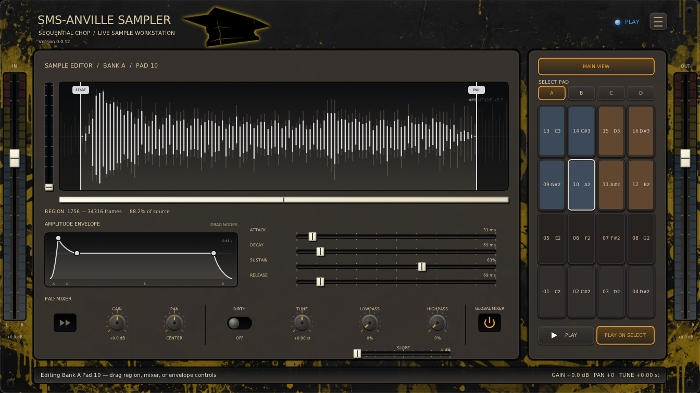
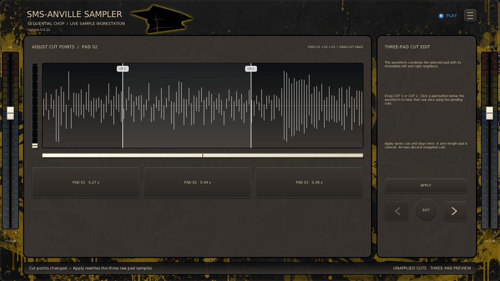
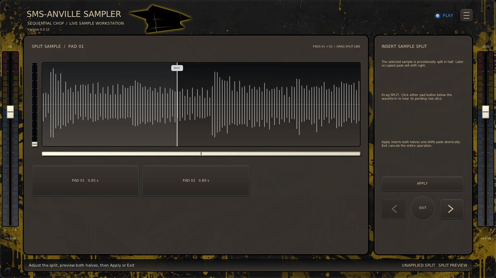

# SMS-Anville Sampler

> [!WARNING]
> 
> **STILL IN ALPHA - PLEASE WAIT FOR v1.0.0 BEFORE USING**

_A live stereo chopping sampler._ See [Releases](https://github.com/sirsipe/SMS-Plugins/releases) for downloads.
 - Linux VST3 (preferred)
 - Linux LV2
 - Windows VST3 (experimental)


> Thanks to **Manolo Anville** ([@ManoloAnville](https://github.com/ManoloAnville)) for collaboration.

[](Docs/main-view.png)

#### Bundled Skins
*Skins can be freely customized, see [skins](Docs/SKINS.md).*

| Finnish Dream | Anville Graffiti |
| --- | --- |
| [](Docs/main-view-finnish-dream.png) | [](Docs/main-view-anville-graffiti.png) |

Captures: v0.0.12.

**VST3 is preferred** for faster GUI loading and more comprehensive testing. LV2 is mostly AI-tested, and Windows VST3 has had minimal testing.

Tested in: **REAPER**, **Ardour**, **Carla**. (But all DAW supporting VST3 should work.)

- MIDI control; capture/chop input or load samples into pads.
- Waveform editing and splitting.
- Pad/global mixer and FX: per-pad Forward/Reverse, Gain, Pan, Dirty, Tune (Varispeed), Lowpass/Highpass (6/12/24 dB/octave), independent monitor/playback levels.
- Per-sample ADSR.
- 2x4, 3x4, or 4x4 pads; four shared/unique MIDI banks; pad colors.
- VST3 presets transfer samples/settings between Ardour and REAPER; Carla lacks support.
- Create [custom skins](Docs/SKINS.md).

> v1.0.0+ is incompatible with alpha sessions (v0.0.1–v0.9.9). Alpha releases were removed from GitHub to avoid confusion.

## Basic Usage

1. Insert as an instrument on a REAPER track receiving stereo audio/MIDI, or an
   Ardour MIDI track with stereo input sidechain for capture. Rescan after
   upgrades if listed as FX.

2. Press **ARM** (red record circle) to arm; release for PLAY. Indicators are red
   ARMED and green PLAY by default; skins can recolor them. The first empty visible pad is
   selected; click another while idle.

3. **Any MIDI note-on or Space press starts the first slice.** Later taps close
   the current slice and continue at the next pad.

4. **FINALIZE** or releasing **ARM** keeps the open slice. **UNDO** discards the
   open/last slice; **CLEAR** clears banks after confirmation.

5. Right-click a pad to edit, split, or adjust neighbouring cuts.

### ARM view


### Menus


Hamburger: **PAD LAYOUT**, **BANK MODE**, **SKIN**, **LINKS**. Online Help opens this
guide; Report Issue opens the project issues.

**All Banks** (default) uses unique notes for gapless play; **Selected Bank** shares
notes within the active bank. All Banks base note is limited to 64.

Layouts preserve samples.


### Sample Editor view

**SAMPLE EDITOR** opens waveform, ADSR, and pad mixing; **MAIN VIEW** returns. See the
[mixing guide](Docs/MIXING.md). The selection button cycles **Play on Select**,
**Loop on Select**, and Off (unpressed **Play on Select**). Play auditions once; Loop repeats Start/End after
release, restarting ADSR each pass with live edits. These modes are independent
of main playback. Selection changes replace auditions; disabling or leaving stops
auditioning. **Play/Stop** auditions the selected occupied pad when idle or cuts all
samples. With Loop on Select, it and Space loop. ARM hides the global mixer;
edge faders stay visible. **IN** monitors and **OUT** controls samples and previews.

**Ctrl + wheel** zooms; **Shift + wheel** scrolls. The left zoom control and
window box provide drag alternatives. Changing pads resets the view.

[](Docs/sample-editor.png) 

#### Alternative skins
| Finnish Dream | Anville Graffiti |
| --- | --- |
| [](Docs/sample-editor-finnish-dream.png) | [](Docs/sample-editor-anville-graffiti.png) |


### Adjust Cut Points view

Right-click a middle pad for **Adjust cut points**. See the
[cut-point guide](Docs/CHOP-EDITOR.md).

[](Docs/adjust-cut-points.png)

#### Alternative skins
| Finnish Dream | Anville Graffiti |
| --- | --- |
| [](Docs/adjust-cut-points-finnish-dream.png) | [](Docs/adjust-cut-points-anville-graffiti.png) |


### Split sample view

Right-click for **Split Sample**; following samples shift right without being overwritten.

[](Docs/split-sample.png) 

#### Alternative skins
| Finnish Dream | Anville Graffiti |
| --- | --- |
| [](Docs/split-sample-finnish-dream.png) | [](Docs/split-sample-anville-graffiti.png) |


## General Controls

- Drag/wheel knobs and sliders.
- **Shift** gives 10× knob precision; **Ctrl** steps Gain/Volume 1 dB, Pan 10%, Tune one semitone.
- Double-click values to enter exact values; double/middle-click knobs, ADSR, or
  edge faders to reset.
- The wheel adjusts ADSR, Start/End, and cuts.
- Click the plug-in for keyboard focus. **Space** plays/stops in PLAY/editor or
  starts/chops ARM capture; holding does not repeat. Menus, dialogs, numeric entry,
  and cut-point views suppress it. The plug-in consumes delivered Space; if the
  DAW intercepts it first, enable sending keys to the plug-in.

## Other controls

- Sample memory: ~8 minutes.

- Monitor cycles Off, On, and Auto (on when ARMed).

- Max Voices limits simultaneous pads; a new trigger stops the oldest at
capacity. Set it to one for monophonic playback.

- **Hold** loops Start/End while its MIDI note or mouse press is held. Release
starts the ADSR fade; looping continues until it ends. ARM stops Hold; **One Shot**
ignores note-off.

- Pre-roll moves boundaries earlier for late taps; Fixed mode records one fixed
length slice per note-on.

- New sessions start with Auto monitoring, one voice, Play on Select, and
6 dB/octave filter slopes.

- Pad right-click: copy, paste, import, export, clear, split, collapse gaps.
  Split/Collapse Gap stay within the active bank; copies can cross banks.

- Right-click a pad for **Color**; tint persists when empty.

- See [WAV files](Docs/WAV-FILES.md) for import formats and Linux requirements.

- DAW projects store all banks as 16-bit stereo.

- Stereo LEDs show raw input/final output.

## Skins

Default uses no skin. **Hamburger → Skin** offers bundled **Anville Graffiti**
and **Finnish Dream**, remembering your choice. 

Skins can be freely customized, see [skins](Docs/SKINS.md).

### Skin: Default
 [](Docs/main-view.png) 

### Skin: Finnish Dream
[](Docs/main-view-finnish-dream.png)

### Skin: Anville Graffiti
[](Docs/main-view-anville-graffiti.png)
 
## Vision, Contributions, License

Development/testing: [Contributing](../CONTRIBUTING.md).

License: [MIT](LICENSE).

Product direction: [Vision](Docs/VISION.md).

## Build

Ubuntu/Debian prerequisites:

```bash
sudo apt install build-essential cmake ninja-build pkg-config git python3 \
  lv2-dev libgl1-mesa-dev libx11-dev libxext-dev \
  libxrandr-dev libxcursor-dev libxinerama-dev libdbus-1-dev xdg-utils
```

From the repository root:

```bash
git submodule update --init --recursive
cmake -S SMS-AnvilleSampler -B build -G Ninja \
  -DCMAKE_BUILD_TYPE=Release -DBUILD_TESTING=ON \
  -DANVILLESAMPLER_BUILD_VST3=ON
cmake --build build
ctest --test-dir build --output-on-failure
```

The VST3 and LV2 bundles are produced under `build/bin`. Install them for the
current user with:

```bash
mkdir -p ~/.lv2
cp -a build/bin/SMS-AnvilleSampler.lv2 ~/.lv2/
mkdir -p ~/.vst3
cp -a build/bin/SMS-AnvilleSampler.vst3 ~/.vst3/
```

## Technical Architecture

See [Technical Architecture](../Docs/ARCHITECTURE.md).
