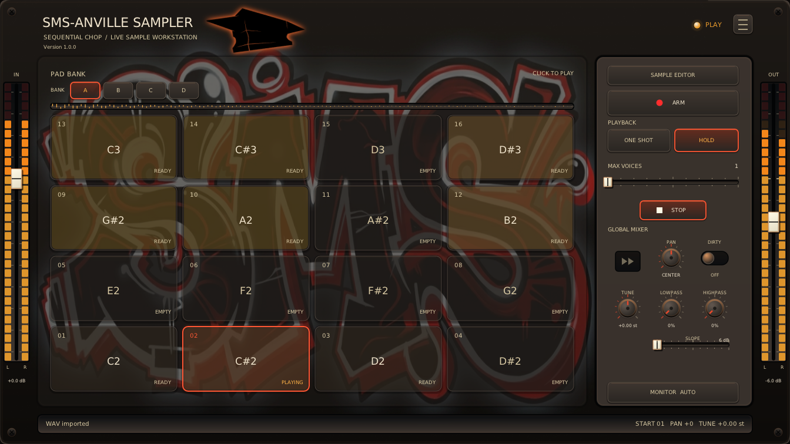
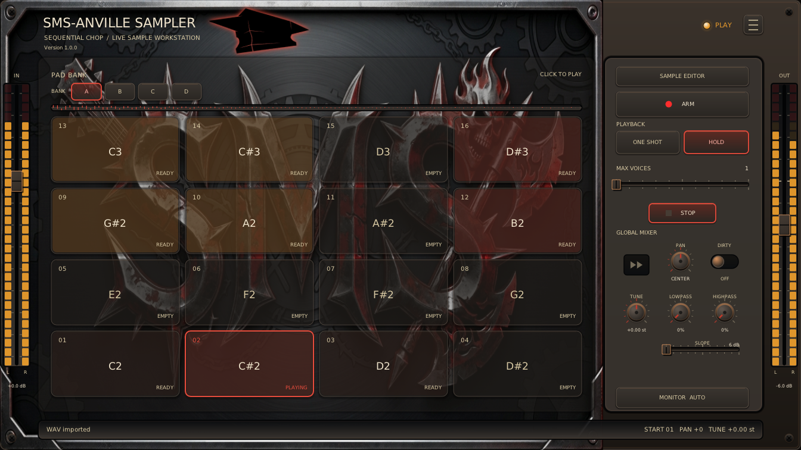

# Additional SMS-Anville Sampler skins

These optional skins supplement the three bundled choices. Open this page from
**hamburger → SKIN → `<Get More>`** in SMS-Anville Sampler.

## Available skins

### [Red Black SMS Tag](RedBlackSMSTag/)

*Warm red, orange and gold with SMS artwork.*

[**Download** using https://download-directory.github.io/](https://download-directory.github.io/?url=https://github.com/sirsipe/SMS-Plugins/tree/main/SMS-AnvilleSampler/additional-skins/RedBlackSMSTag)

[](RedBlackSMSTag.png)

> Author: [@ManoloAnville](https://github.com/ManoloAnville)

### [Xtreme SMS Metall](XtremeSMSMetall/)

*Dark red with metal-inspired SMS artwork.*

[**Download** using https://download-directory.github.io/](https://download-directory.github.io/?url=https://github.com/sirsipe/SMS-Plugins/tree/main/SMS-AnvilleSampler/additional-skins/XtremeSMSMetall)

[](XtremeSMSMetall.png)

> Author: [@ManoloAnville](https://github.com/ManoloAnville)

## Install

Download a skin using its link above and extract the ZIP. Keep `skin.ini` and
its artwork together in a folder named for the skin, such as `RedBlackSMSTag`.
If the ZIP contains only the files, create that folder first. The final layout
must be `RedBlackSMSTag/skin.ini` with the artwork beside it, without an extra
nested folder.

Close the plugin editor. Copy the skin folder into the collection beside your
installed plugin's existing skins:

| Platform and format | Typical collection folder |
| --- | --- |
| Linux VST3 | `~/.vst3/SMS-AnvilleSampler.vst3/skins/` |
| Linux LV2 | `~/.lv2/SMS-AnvilleSampler.lv2/skins/` |
| Windows VST3 | `C:\Program Files\Common Files\VST3\SMS-AnvilleSampler.vst3\skins\` |

Use your actual installation location if it differs.

For example, Linux VST3 should contain:

```text
~/.vst3/SMS-AnvilleSampler.vst3/skins/RedBlackSMSTag/skin.ini
~/.vst3/SMS-AnvilleSampler.vst3/skins/RedBlackSMSTag/sms.png
```

Reopen the editor and choose the skin under **hamburger → SKIN**. Restart the
host if it keeps the editor loaded after closing its window. The selection is
remembered for future editors.

A forced `skin/` override hides the SKIN menu. See the
[skin guide](../Docs/SKINS.md) for overrides, discovery rules and creating your
own skin.

## Manual download

Download the entire skin folder, including `skin.ini` and its artwork. You can
use [Download Directory](https://download-directory.github.io/) by pasting the
skin folder's GitHub URL; the download links above already include it.
Alternatively, download the repository ZIP from GitHub's **Code → Download ZIP**
menu and extract the desired folder from `SMS-AnvilleSampler/additional-skins/`.
Then follow the installation instructions above.
